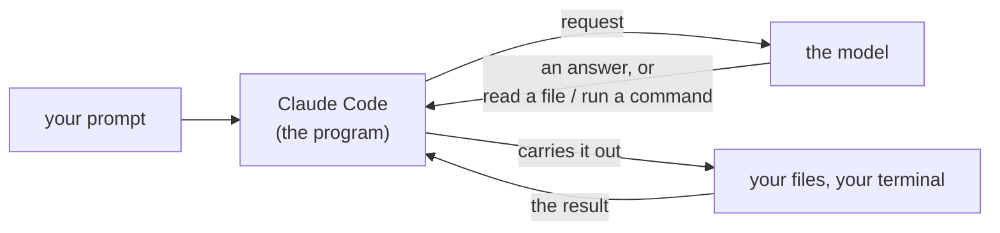

# What Claude Code actually is

The files from the Short **"What Claude Code Actually Is (Not Just the Chat in VS Code)"**.

## The idea

The Claude chat in VS Code is one window into Claude Code. Claude Code itself is a separate program: it turns your
prompt into a request to the model, and what comes back is either an answer or an instruction to read a file or run
a command. It carries out the instruction, sends the result back, and goes around again until the job is done.

In the chat, you decide when it's done: you are the check. The other way is to write the check down. This folder is
the small example from the Short: one file says what to build, one says how to know it's done, and one command runs
Claude Code until the tests pass.



## The files

| File | What it is | Who wrote it |
|---|---|---|
| [`TASK.md`](TASK.md) | What to build: `slugify(title)`, and its four rules | written before the run |
| [`slugify.test.js`](slugify.test.js) | How to know it's done: three tests covering the rules | written before the run |
| [`package.json`](package.json) | Makes `npm test` run the tests | written before the run |
| [`slugify.js`](slugify.js) | The function | Claude Code, in the run (comments added afterwards) |

## Try it

```sh
npm test                      # passes
rm slugify.js && npm test     # fails without Claude Code's work
claude -p "Build what TASK.md says. Keep going until npm test passes." \
  --permission-mode acceptEdits \
  --allowedTools "Bash(npm test)"
npm test                      # passes again
```

The next folder, [`01-walk-away`](../01-walk-away), does the same with a bigger task: a URL shortener.
