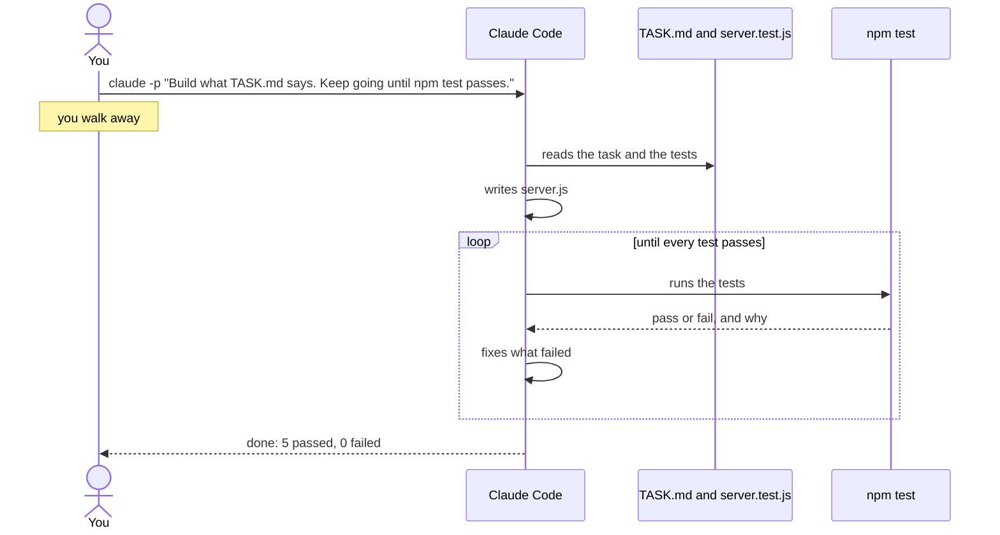

# Give Claude Code a task and walk away

The files from the Short **"Give Claude Code a task and walk away"**.

## The idea

When you use Claude Code through the chat in VS Code, you ask, read, and decide when it's done: you are the check.
This folder shows the other way. You write down what you want and how to know it's done, run one command, and
leave. Claude Code writes the code, runs the tests, fixes what fails, and stops only when they all pass.

## The files

| File | What it is | Who wrote it |
|---|---|---|
| [`TASK.md`](TASK.md) | What to build: a small URL shortener, and its seven rules | written before the run |
| [`server.test.js`](server.test.js) | How to know it's done: five tests that check all seven rules | written before the run |
| [`package.json`](package.json) | Makes `npm test` run the tests | written before the run |
| [`server.js`](server.js) | The URL shortener | Claude Code, in the run (comments added afterwards) |

## The run

```sh
claude -p "Build what TASK.md says. Keep going until npm test passes." \
  --permission-mode acceptEdits \
  --allowedTools "Bash(npm test)"
```

In the recorded run it read `TASK.md`, read the tests, wrote `server.js`, and ran `npm test`. All five passed on the
first run, 27 seconds after the command started, with no messages from anyone.



## Why the tests matter

Without a check, Claude Code stops when it thinks it's done, and that's not the same thing. The tests are what let
you walk away: it can't finish until they pass. The next folder, [`02-tests`](../02-tests), is how to write them.

## Try it

```sh
npm test                      # passes
rm server.js                  # take Claude Code's work away
npm test                      # fails
claude -p "Build what TASK.md says. Keep going until npm test passes." --permission-mode acceptEdits --allowedTools "Bash(npm test)"
npm test                      # passes again (its server.js will differ from this one, and that's fine)
```
