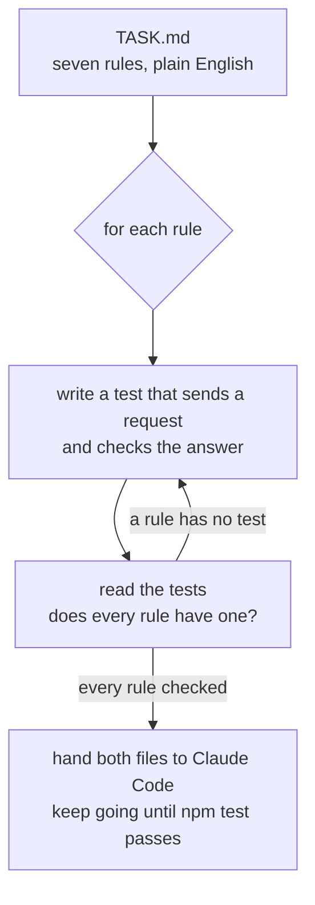

# How to write the tests Claude Code works toward

The files from the Short **"How to write the tests Claude Code works toward"**. They are the same URL shortener as
[`01-walk-away`](../01-walk-away); this folder is about the tests.

## The idea

The task file is plain English. The tests are code, because Claude Code has to run them and see pass or fail. A
test is the only thing that can tell it "not done yet", so the tests decide what you get:

- **Start from the rules.** Every rule in `TASK.md` needs a test that checks it.
- **Test from the outside.** Send a request and check the answer, the way a user sees it, not how the code works
  inside. Then any working code passes, and broken code doesn't.
- **Test the things that would hurt you.** If a rule has no test, nothing checks it, so bad input gets tests too.
- **You don't have to type them.** Ask Claude Code to write the tests first, from your task file, and read them
  before it builds anything: "Write the tests for TASK.md first. Don't build anything yet."



## Every rule, and the test that checks it

| Rule in [`TASK.md`](TASK.md) | Test in [`server.test.js`](server.test.js) |
|---|---|
| POST /links with {"url"} returns 201 and {"code"} | shortens a url to a 6-character code |
| codes are 6 letters or digits | shortens a url to a 6-character code |
| GET /&lt;code&gt; redirects (302) to the url | redirects and counts visits |
| unknown codes are 404 | unknown code is 404 |
| a url that isn't http or https is 400 | rejects a url that is not http or https |
| the same url always gets the same code | the same url gets the same code |
| GET /links/&lt;code&gt;/stats returns {"url", "visits"} | redirects and counts visits |

Seven rules, five tests, and every rule is checked. When they pass, you know what you got.

## Try it

```sh
npm test    # 5 passed: every rule holds for the server.js Claude Code wrote
```

Break a rule in `server.js` (say, return 200 instead of 400 for a bad url) and run `npm test` again: the test for that
rule fails and names it.
