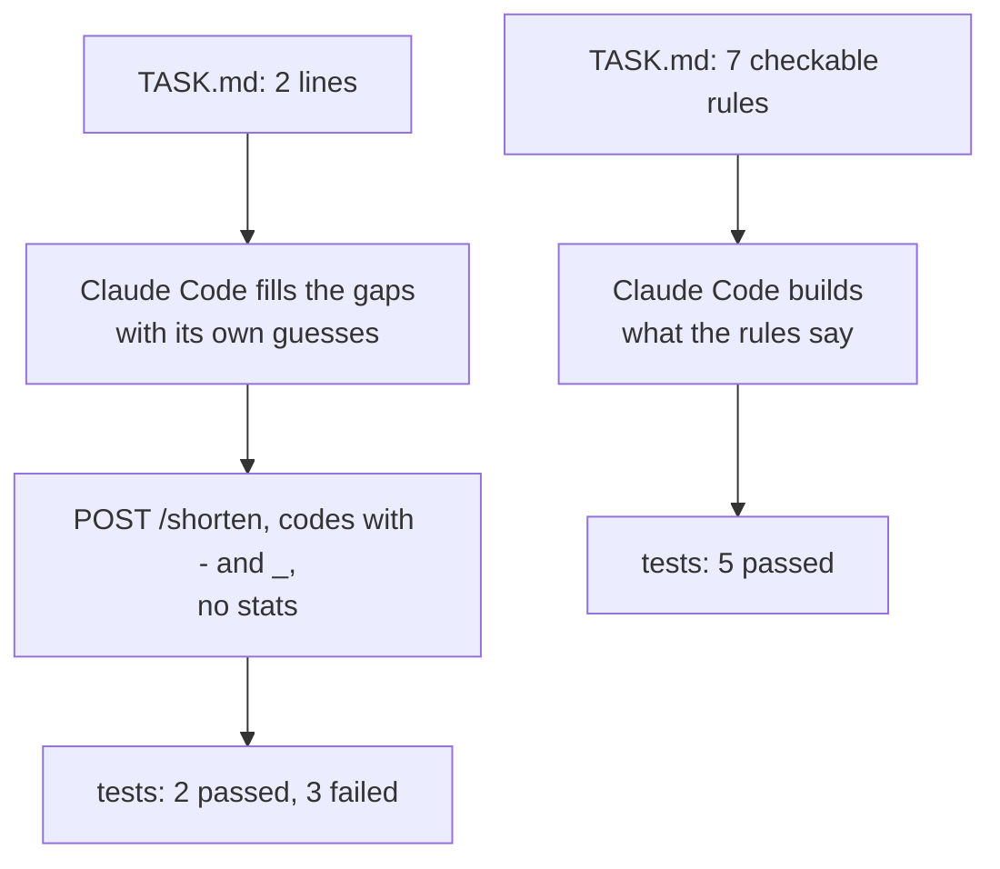

# Write a task file Claude Code can't misread

The files from the Short **"Claude Code Spec Driven Development: Write a Task File It Can't Misread"**.

## The idea

Claude Code does what the task file says, and where the file is silent, it guesses. The guesses are usually
reasonable, and that's the problem: a reasonable guess that isn't what you wanted still fails your tests.

Here is the same job, the same command, run twice, with **no tests in the folder**, so the task file was the only
thing Claude Code had to go on:

```sh
claude -p "Build what TASK.md says." --permission-mode acceptEdits
```

Then the five tests from [`01-walk-away`](../01-walk-away) were copied in and run.

| Folder | The task file | What Claude Code built | The tests |
|---|---|---|---|
| [`vague`](vague) | Two lines: a URL shortener in server.js, exporting `start(port)` | A working shortener on `POST /shorten`, codes that can contain `-` and `_`, no visit stats | 2 passed, 3 failed |
| [`precise`](precise) | The same two lines, plus seven rules, each a request and its answer | The shortener the rules describe | 5 passed, 0 failed |

(One of the vague build's two passes, "the same url gets the same code", passed only because both answers were 404s.)



## How to write the rules

Write every rule so a test could check it. Name the request and the answer:

- **the address**: `POST /links with {"url"} returns 201 and {"code"}`
- **the format**: `codes are 6 letters or digits`
- **the error**: `a url that isn't http or https is 400`
- **the edge case**: `the same url always gets the same code`

If you would test it, write it down. Then the tests in [`02-tests`](../02-tests) check exactly those rules.

## Try it

```sh
cd vague && npm test      # 2 passed, 3 failed
cd ../precise && npm test # 5 passed
```
