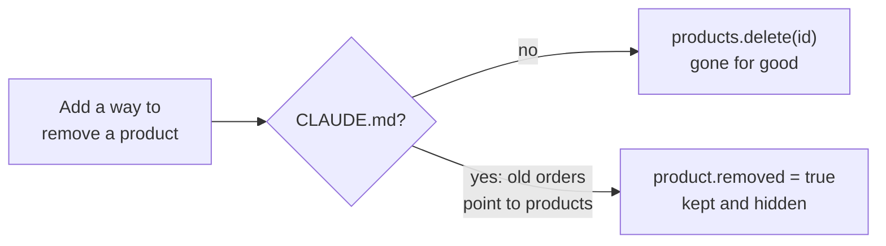

# CLAUDE.md: what to put in it, and what not to count on

The files from the Short **"CLAUDE.md Best Practices: What Claude Code Can't Guess"**.

## The idea

Claude Code reads `CLAUDE.md` at the start of every session: notes about your project, so you don't repeat yourself.
Most of the rules people put there, it already follows. What it can't do is know things about your project that
aren't in the code.

## What it already does

With no CLAUDE.md at all, it wrote tests, stored money in whole cents, and made a ticket branch with the ticket number
in the commit message. The runs are in [`already-does`](already-does).

## What it can't see

The request `claude -p "Add a way to remove a product."` on the same small products API, run twice:

| Folder | CLAUDE.md | What Claude Code built |
|---|---|---|
| [`without`](without) | none | `products.delete(id)`: the product is gone for good, though old orders point to it |
| [`with`](with) | [one line](with/CLAUDE.md): products are never deleted, old orders point to them | `product.removed = true`: the product is kept and hidden |



## What to put in it

- **What it can't see**: facts about your project that aren't in the code, like `Products are never deleted: old
  orders point to them.`
- **Not** what it already does. Before you add a rule, run the job without it. If it already does it, leave the rule
  out. A short CLAUDE.md is easier to follow than a long one.

## Don't count on it

Claude Code doesn't always follow CLAUDE.md. It's there so you don't have to repeat yourself, not to guarantee
anything. Anything you can't afford to get wrong needs a test (or, to make it impossible, a hook: see the
[spec-first plugin](../plugins/spec-first)).

## Try it

```sh
cd with && npm test
```
