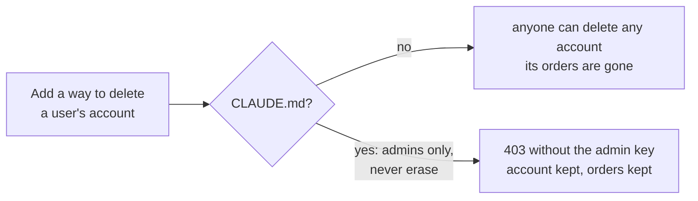

# CLAUDE.md: what Claude Code can't guess

The files from the Short **"CLAUDE.md Best Practices: What Claude Code Can't Guess"**.

## The idea

Claude Code reads `CLAUDE.md` at the start of every session: your project's rules, so you don't repeat them in every
prompt. The question is what to put in it, and what to do about the times it doesn't follow it.

The same request, on the same small user accounts API (users and their orders), run twice:

```sh
claude -p "Add a way to delete a user's account." --permission-mode acceptEdits --allowedTools "Bash(npm test)"
```

| Folder | CLAUDE.md | What Claude Code built |
|---|---|---|
| [`without`](without) | none | `DELETE /users/<id>` with no check of who asks, and `users.delete()`: **anyone can delete anyone's account, and the orders go with it** (its own code comment says so) |
| [`with`](with) | [three rules](with/CLAUDE.md) | 403 without the admin key; the account marked deleted, not erased; 410 for a deleted account; the orders kept |



## What to put in it

Rules Claude Code **can't guess**, because they're your decisions, not good practice:

- **Who's allowed to do what**: `Only admins delete accounts: the header x-admin-key must equal ADMIN_KEY, or 403.`
- **What must never happen**: `Accounts are never erased: a deleted account is marked deleted, and its orders are kept.`

Generic rules ("write tests", "run npm test before you're done") changed nothing in an earlier try: it already does
those.

## It doesn't always follow it

CLAUDE.md is instructions, not enforcement. Claude Code usually follows it, and sometimes it doesn't. So every rule
that really matters gets a test. In [`with/server.test.js`](with/server.test.js), a test deletes an account without
the admin key and expects 403; if Claude Code ever ignores the rule, that test fails. (To make a rule impossible to
break, use a hook: see the [spec-first plugin](../plugins/spec-first).)

## Try it

```sh
cd with && npm test       # 16 passed, including the 403 test
```
