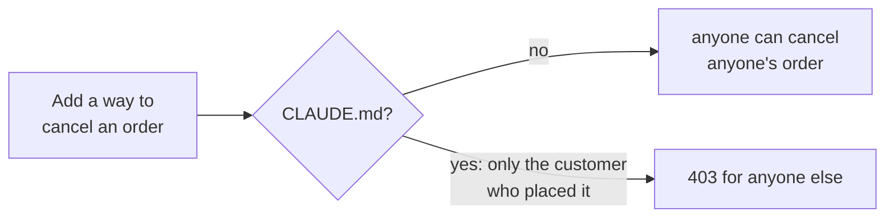

# CLAUDE.md: what Claude Code can't guess

The files from the Short **"CLAUDE.md Best Practices: What Claude Code Can't Guess"**.

## The idea

Claude Code reads `CLAUDE.md` at the start of every session: your project's rules, so you don't repeat them in every
prompt. The question is what to put in it, and what to do about the times it doesn't follow it.

The same request, on the same small online store orders API, run twice:

```sh
claude -p "Add a way to cancel an order." --permission-mode acceptEdits --allowedTools "Bash(npm test)"
```

| Folder | CLAUDE.md | What Claude Code built |
|---|---|---|
| [`without`](without) | none | `POST /orders/<id>/cancel` with no check of who asks: **anyone can cancel anyone's order**. (It did guess on its own that a shipped order can't be cancelled.) |
| [`with`](with) | [three rules](with/CLAUDE.md) | 403 unless the `x-customer-id` header is the customer who placed the order; 409 for a shipped order; 10 of 10 tests pass |



## What to put in it

Rules Claude Code **can't guess**, because they're your decisions, not good practice:

- **Who's allowed to do what**: `Only the customer who placed an order can cancel it: the header x-customer-id must match the order's customerId, or 403.`
- **What must never happen**: `A shipped order can never be cancelled: 409.` (Here it guessed this one on its own; the rule makes sure.)

Generic rules ("write tests", "run npm test before you're done") changed nothing in an earlier try: it already does
those.

## It doesn't always follow it

CLAUDE.md is instructions, not enforcement. Claude Code usually follows it, and sometimes it doesn't. So every rule
that really matters gets a test. In [`with/server.test.js`](with/server.test.js), a test cancels someone else's order
and expects 403; if Claude Code ever ignores the rule, that test fails. (To make a rule impossible to
break, use a hook: see the [spec-first plugin](../plugins/spec-first).)

## Try it

```sh
cd with && npm test       # 10 passed, including the 403 test
```
