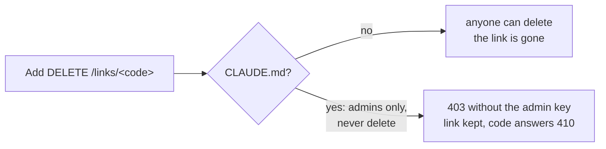

# CLAUDE.md: what Claude Code can't guess

The files from the Short **"CLAUDE.md Best Practices: What Claude Code Can't Guess"**.

## The idea

Claude Code reads `CLAUDE.md` at the start of every session: your project's rules, without repeating them in every
prompt. The question is what to put in it.

The same request, on the same code (the URL shortener from [`01-walk-away`](../01-walk-away)), run twice:

```sh
claude -p "Add DELETE /links/<code>, which removes a link." --permission-mode acceptEdits --allowedTools "Bash(npm test)"
```

| Folder | CLAUDE.md | What Claude Code built |
|---|---|---|
| [`without`](without) | none | `links.delete(code)` with no check of who asks: **anyone can delete any link, and it's gone for good** |
| [`with`](with) | [three rules](with/CLAUDE.md) | an admin check (`x-admin-key`, else 403); the link kept and marked removed; its code answers 410; 6 of 6 tests pass |



## What to put in it

A first try with generic rules ("write a test for every endpoint", "run npm test before you're done", "JSON errors",
"no packages") changed nothing: Claude Code did all of those without being told. What changed the result were rules
it **can't guess**, because they're your decisions, not good practice:

- **Who's allowed to do what**: `Only admins change links: the header x-admin-key must equal ADMIN_KEY, or 403.`
- **What must never happen**: `Links are never deleted from storage: a removed link is marked removed, and its code answers 410.`

Copy [`with/CLAUDE.md`](with/CLAUDE.md) and replace those rules with your project's.

## Try it

```sh
cd with && npm test       # 6 passed, including the new delete test
```
