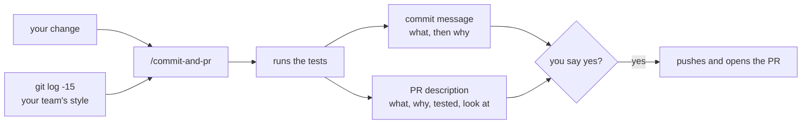

# A real run of the commit-and-pr plugin

The plugin is in [`plugins/commit-and-pr`](../plugins/commit-and-pr), with how to install it. This folder is one real
run of it, on Joel's public RAG project, `joelstevick-demo-rag-pipeline` (the pull request was opened for this
example and closed without merging).

## The change

Keyword search split words on every apostrophe, so "don't" became "don" and "t", and a search for "dont" missed it.
The fix drops an apostrophe inside a word before searching. It's in [`change.diff`](change.diff).

## What the skill did

With the change in the working tree, one command:

```
/commit-and-pr
```

1. It read every change (`git diff`) and the last 15 commit messages ([`earlier-log.txt`](earlier-log.txt)), to
   write in the repository's style.
2. It ran the tests: all 51 passed.
3. It wrote the commit message ([`commit-message.txt`](commit-message.txt)): a first line saying what the change
   does, then why.
4. It wrote the pull request description ([`pr-description.md`](pr-description.md)): what, why, how it was tested,
   and something for the reviewer to look at (possessives like "invoice's" change too).
5. It committed the two changed files, showed both, and asked before pushing. On "yes", it pushed the branch and
   opened the pull request.


