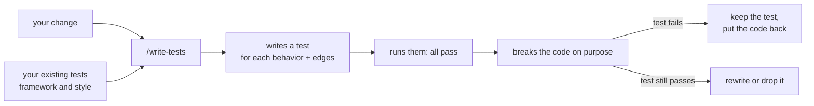

# A real run of the write-tests plugin

The plugin is in [`plugins/write-tests`](../plugins/write-tests), with how to install it. This folder is one real
run of it, on Joel's public RAG project, `joelstevick-demo-rag-pipeline` (the change was never pushed; the repository
was put back as it was).

## The change

Search should ignore accents, so a search for "cafe" finds "café" and "resume" finds "résumé". One line in
`demo/src/retrieval.ts` ([`change.diff`](change.diff)), written with no tests.

## What the skill did

```
/write-tests
```

1. It read the change and the project's existing tests (vitest, in `demo/tests/`), and wrote seven tests in the same
   style: [`retrieval.test.ts`](retrieval.test.ts). Accented words, capital letters, two ways of typing an accent,
   plurals, search in both directions, empty text, and the behavior that worked before.
2. It ran them: all pass.
3. For each test, it broke the changed code on purpose (undid the change, dropped the accent removal, made empty text
   return `['']`, turned off the stop words), checked that the test failed, and put the code back. Every test failed
   at least once. The code ended exactly as it was, and the full suite passed: 55 tests.
4. It reported what isn't handled: letters like `ß` still split a word ("straße" becomes "stra" and "e"). The full
   report is [`report.md`](report.md).



A test that can't fail when the code is broken protects nothing. That's the step that makes these tests worth keeping.
