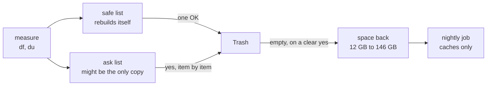

# A real run of the free-disk-space plugin

The plugin is in [`plugins/free-disk-space`](../plugins/free-disk-space), with how to install it. This folder is the
real run on Joel's Mac, 2026-11-16.

**12 GB free before, 146 GB after.**

1. **Measured** ([`scan.md`](scan.md)): about 50 GB that rebuilds itself (caches, build output, `node_modules` in 42
   projects untouched for 30+ days), 68 GB of Cloudflare Wrangler logs, and a list of big files to ask about.
2. **Asked:** Joel said yes to the safe list, the Wrangler logs, a WebStorm crash dump and an old installer; no to a
   20 GB zip of old repos, the week's video footage and the simulators.
3. **Moved 120 GB to the Trash** ([`move-to-trash.sh`](move-to-trash.sh), the moves the skill planned).
4. **Emptied the Trash, and the space didn't come back:** 16 Time Machine local snapshots were holding the deleted
   files. Clearing them (`tmutil thinlocalsnapshots`) brought it back. With no backup drive attached, those were the
   only local restore points, so this step is permanent: decide it yourself.
5. **Nightly job:** at 3:00 it clears caches that rebuild themselves and tool logs older than a week
   ([`nightly/`](../plugins/free-disk-space/nightly)). The first run freed 165 MB.

The details, with every size: [`result.md`](result.md).

