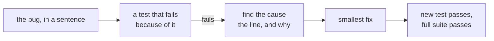

# A real run of the fix-bug plugin

The plugin is in [`plugins/fix-bug`](../plugins/fix-bug), with how to install it. This folder is one real run, on a
real bug in Joel's public RAG project, `joelstevick-demo-rag-pipeline` (the fix was never pushed; the repository was
put back as it was).

## The bug

A keyword search for a word in a Greek or Russian document found nothing. `words()` turned
`Η πληρωμή του τιμολογίου` into `[]`.

```
/fix-bug Keyword search finds nothing in a document written in Greek or Russian.
```

## What the skill did

1. **Reproduced it:** wrote the test "finds a Greek or Russian word by keyword search alone" and ran it. It failed: a
   search for πληρωμή returned the English document.
2. **Found the cause:** `demo/src/retrieval.ts:37` tokenized with `/[a-z0-9]+/g`, so any letter outside a to z was
   dropped.
3. **Fixed it with one line:** `/[\p{L}\p{N}]+/gu`, letters and digits of any script ([`fix.diff`](fix.diff)). The
   new test passed, and so did the other 48; typecheck clean. After: [`after.txt`](after.txt).
4. **Said what's still not fixed:** Chinese and Japanese (no spaces between words), English-only stop words. The
   full report is [`report.md`](report.md).



No failing test, no fix: a fix you can't show failing first is a guess.
