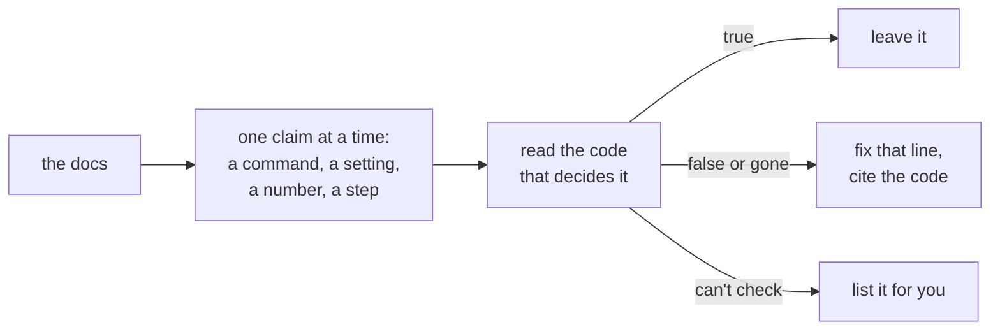

# A real run of the update-docs plugin

The plugin is in [`plugins/update-docs`](../plugins/update-docs), with how to install it. This folder is one real run
on Joel's public RAG project, `joelstevick-demo-rag-pipeline`. The edits were never pushed; the repository was put
back as it was.

```
/update-docs
```

## What the skill did

1. **Checked about 75 claims** in `README.md` and `evals/README.md`, one at a time: commands, settings, numbers, line
   links, the steps of the flow. For each one it read the code that decides it.
2. **Found 73 still true.**
3. **Fixed the 2 that weren't** ([`docs.diff`](docs.diff)):
   - The README said a streamed answer stops only when "a later sentence failed its check". The code also stops it
     when the model fails partway (`demo/src/app.ts:445`, reason `'trouble'`).
   - The eval README's results table didn't say what a cut-short answer looks like (`evals/run.mjs:276`).
4. **Said what it couldn't check:** running the eval spends money, and deploying needs Cloudflare credentials. The full
   report is [`report.md`](report.md).



The code is the source of truth, not another doc or a comment.
