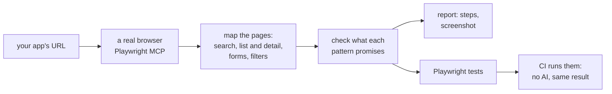

# A real run of the test-in-browser plugin

The plugin is in [`plugins/test-in-browser`](../plugins/test-in-browser), with how to install it. This folder is one
real run, on a local build of Joel's own site, joelstevick.com: the episode list at `/learn` with its 25 episode pages
(a list and a detail page), and the blog's tag filter. Nothing was pushed; the copy was thrown away.

```
/test-in-browser http://localhost:8811 the episode list at /learn with its episode pages, and the blog's tag filter at /blog
```

## What it did (3 minutes)

1. **Drove a real browser** through the Playwright MCP server: clicked every episode, followed previous and next
   through the whole path, filtered the blog by every tag, pressed Back, reloaded, opened addresses directly, and
   resized to a phone.
2. **Found one real bug:** `/blog?tag=Evals` filters, but `/blog?tag=evals` shows every post. The tag lookup matches
   capital letters exactly (`scripts/blog.mjs:184`).
3. **Checked the rest worked:** each clicked episode is the page that opens, the totals add up, a missing episode is a
   404, every tag shows only its posts, a filter survives Back and reload, nothing breaks at phone width.
4. **Wrote 7 Playwright tests** ([`learn-blog-browser.spec.ts`](learn-blog-browser.spec.ts)) in the site's own
   style: 6 pass, and 1 fails on the bug until it's fixed. They need no AI, so CI runs them.
5. **Said what it couldn't check:** the server code wasn't running in this local copy. Full report:
   [`report.md`](report.md).



Claude Code explores; CI runs the tests it wrote.
