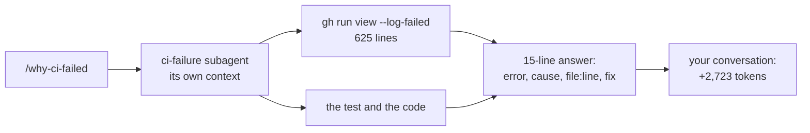

# A real run of the ci-failure plugin

The plugin is in [`plugins/ci-failure`](../plugins/ci-failure), with how to install it. This folder is one real run
on a real CI failure in an open-source project: a pull request to [Vite](https://github.com/vitejs/vite) whose CI run
([44567079575](https://github.com/vitejs/vite/actions/runs/44567079575)) failed on one job of nine,
`Build&Test: node-26, windows-latest`. The failed job's log is 625 lines, 92 KB.

The same question was asked twice, each in a fresh Claude Code session in a checkout of the pull request
(2026-11-19):

| | Through the subagent | The main session reads the logs itself |
|---|---|---|
| The prompt | `/why-ci-failed <run URL>` | "CI failed on this pull request: <run URL>. Find out why." |
| The answer | [`with-subagent.md`](with-subagent.md) | [`without-subagent.md`](without-subagent.md) |
| What the main conversation grew by | **2,723 tokens** | **18,275 tokens** |
| Cost | $0.78 | $1.13 |

Both found the same cause: the pull request's new test builds its fixture path with `path.join` (backslashes on
Windows), but Vite's module graph keys files by forward-slash paths, so on Windows the test never invalidates the
module and the cached result comes back. The fix is `normalizePath(...)` around the path, in the test. Neither run
had a Windows machine to prove it; both say so.

The difference is where the reading happened. Without the subagent, every log excerpt, file and search result stayed
in the conversation for the rest of the session. With it, the subagent did that reading in its own context window and
only its 15-line answer came back.

Token counts are the main conversation's context at its first and last turn, from each session's
`--output-format stream-json` log.
