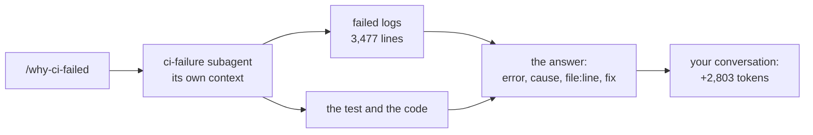

# A real run of the ci-failure plugin

The plugin is in [`plugins/ci-failure`](../plugins/ci-failure), with how to install it. This folder is one real run
on a real CI failure: [Vite](https://github.com/vitejs/vite) pull request
[#24126](https://github.com/vitejs/vite/pull/24126), "fix(optimizer): detect in-place patch file edits in lockfile
hash", merged on 2026-11-18. Its first commit's CI run,
[44071914318](https://github.com/vitejs/vite/actions/runs/44071914318), failed on all six build-and-test jobs. The
failed jobs' logs are 3,477 lines, 512 KB.

## The question, asked twice

Each in a fresh Claude Code session, in a checkout of the failing commit (`df48940`), on 2026-11-19. Neither could see
the fix.

| | Through the subagent | The main session reads the logs itself |
|---|---|---|
| The prompt | `/why-ci-failed <run URL>` | "CI failed on this pull request: <run URL>. Find out why." |
| The answer | [`with-subagent.md`](with-subagent.md) | [`without-subagent.md`](without-subagent.md) |
| What the main conversation grew by | **2,803 tokens** | **26,056 tokens** |
| Cost | $0.78 | $0.92 |

## Was it right? The author's actual fix

The failing assertion was `expected 'e3b0c442' not to be 'e3b0c442'`. `e3b0c442` is the start of the SHA-256 of
an empty string. The subagent said: the new test's fixture has no lockfile, so the hash is of nothing and the new code
never runs; add a lockfile whose format opts into hashing `patches/`, and set the patch file's mtime explicitly with
`fs.utimesSync` so the test doesn't depend on timestamp resolution.

The author's next commit ([`a36ad2f`](https://github.com/vitejs/vite/commit/a36ad2fe5), after which CI passed and
the pull request was merged) made the same two changes. The lockfile differed: the subagent suggested `bun.lock` or
`node_modules/.package-lock.json`; the author used yarn 1's `node_modules/.yarn-integrity` (and a later commit moved
it into the fixture with a `.gitignore`). This is a replay: the author had fixed it two days before these sessions.

```diff
+  // the patches dir is only hashed when a lockfile whose format opts into
+  // it (here: yarn 1's .yarn-integrity) exists
+  fs.mkdirSync(path.join(fixture, 'node_modules'), { recursive: true })
+  fs.writeFileSync(path.join(fixture, 'node_modules/.yarn-integrity'), '{}')
   const hashBefore = getLockfileHash(fixture)
   ...
+  const { atime, mtime } = fs.statSync(patchPath)
+  fs.utimesSync(patchPath, atime, new Date(mtime.getTime() + 1000))
```

Both sessions reached the same cause. The difference is where the reading happened: without the subagent, every log
excerpt, file and search stayed in the conversation for the rest of the session; with it, the subagent read in its
own context window and only its answer came back.



Neither session read all 3,477 lines (the plain one tailed and searched them), so the 26,056 tokens are an ordinary
investigation, not the whole log. Both sessions had a 1,000,000-token window; on a 200,000-token window the difference
is about 12%. One run each.

Token counts are the main conversation's context at its first and last turn, from each session's
`--output-format stream-json` log.
