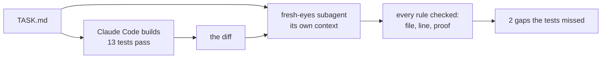

# A real run of the fresh-eyes plugin

The plugin is in [`plugins/fresh-eyes`](../plugins/fresh-eyes), with how to install it. This folder is one real run,
in two steps, each a separate Claude Code session.

## 1. Claude Code builds it

[`TASK.md`](TASK.md) asks for a sign-up and login API with seven rules. [`server.test.js`](server.test.js) checks
four of them. One command:

```sh
claude -p "Build what TASK.md says. Keep going until npm test passes." \
  --permission-mode acceptEdits --allowedTools "Bash(npm test)"
```

It wrote [`server.js`](server.js) and, on its own, 9 more tests for the rules the first file didn't check
([`rules.test.js`](rules.test.js)): **13 of 13 pass.**

## 2. A subagent that never saw it reviews it

```
/fresh-eyes
```

The skill hands the `fresh-eyes` subagent the task and the diff, nothing else. The subagent listed every rule,
checked each against the code with file and line, and probed a running server for what the tests don't cover.
It found two real gaps that all 13 passing tests missed ([`review.md`](review.md)):

1. **A password of six emoji was accepted** as long enough. `password.length` counts each emoji as two, so 🔥🔥🔥🔥🔥🔥
   passed the 12-character rule (`server.js:78`).
2. **Long wrong passwords never counted toward the lockout.** The builder added a 1024-character limit the task never
   asked for, and a login over it returns 401 before the failure count (`server.js:100-103`): nine such tries in a
   row, and the right password still gets in. (Those tries can't guess the password, since sign-up refuses one that
   long, but the rule as written is broken.)

Both were checked again by hand. Nothing was fixed here, so you can see what it found.



## Why a subagent, not a skill

A skill is instructions loaded into the session you're in, so it sees everything the builder saw and thought. A
subagent starts with an empty context and gets only what it's handed. For a review, not knowing is the point.
