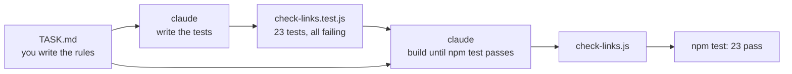

# Claude Code by example: your first project, step by step

The files from the Short **"Claude Code by Example: Your First Project, Step by Step"**: a broken-link checker for
Markdown files. You write the task file; Claude Code writes the tests from it, then the code that passes them.

## Setup

- [Node.js](https://nodejs.org) 20 or later.
- Claude Code, installed and signed in: [setup guide](https://docs.claude.com/en/docs/claude-code/setup)
  (for example `npm install -g @anthropic-ai/claude-code`, then run `claude` once to sign in).

## How the pieces fit

- [`TASK.md`](TASK.md): the rules. What to build, in plain English, one checkable rule per line. You write this.
- [`check-links.test.js`](check-links.test.js): the tests, how Claude Code knows it's finished. Claude Code wrote
  them from `TASK.md`.
- [`check-links.js`](check-links.js): the code. Claude Code wrote it, and it has to pass every test.
- [`package.json`](package.json): one line, so `npm test` runs the tests.



## The steps

1. `mkdir check-links && cd check-links`, then write [`TASK.md`](TASK.md) and [`package.json`](package.json).
2. Start `claude` in the folder and ask for the tests:

   ```
   Write check-links.test.js: a node:test test for each rule in TASK.md, run against a small local web server so the tests never touch the internet. Don't write check-links.js yet.
   ```

   In the recording it wrote 23 tests in 59 seconds, at least one for each rule. All 23 failed, because there was no
   code yet.
3. In the same session, ask for the code:

   ```
   Build what TASK.md says. Keep going until npm test passes.
   ```

   It wrote `check-links.js` in 47 seconds, and all 23 tests passed on the first run. If it asks to write a file or
   run the tests, say yes.
4. Try it on a real README:

   ```sh
   curl -s https://raw.githubusercontent.com/axios/axios/v1.x/README.md -o axios.md
   node check-links.js axios.md
   ```

   On 2026-11-19 it reported `https://angularjs.org/` (line 2811) as a 404: AngularJS support ended in January 2022
   and its home page is gone, but the README still links to it.

Claude Code writes different tests and code on each run; these are the ones from the recording.

## Where it falls short

A link to `localhost` is reported as broken (Express's README has `http://localhost:3000`), because nothing is
running there when you check. Sites that turn scripts away (401, 403, 429) are listed as "blocked", not broken.
