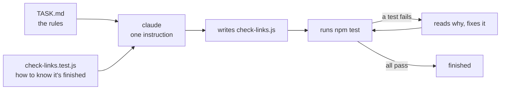

# Your first project with Claude Code, step by step

The files from the video **"Claude Code Tutorial for Beginners: Build Your First Project Step by Step"**: a
broken-link checker for Markdown files, built by Claude Code from a task file and tests.

## Setup

- [Node.js](https://nodejs.org) 20 or later.
- Claude Code, installed and signed in: [setup guide](https://docs.claude.com/en/docs/claude-code/setup)
  (for example `npm install -g @anthropic-ai/claude-code`, then run `claude` once to sign in).

## The steps

1. Make a folder and go into it: `mkdir check-links && cd check-links`
2. **The task file**, [`TASK.md`](TASK.md): what to build, in plain English, one checkable rule per line.
3. **The tests**, [`check-links.test.js`](check-links.test.js): 11 tests that check the rules against a small web
   server on your own machine, so they never touch the internet. Plus a one-line [`package.json`](package.json) so
   `npm test` runs them.
4. Run `npm test`: every test fails, because there's no code yet.
5. Start `claude` in the folder, and type:

   ```
   Build what TASK.md says. Keep going until npm test passes.
   ```

   If it asks to write a file or run the tests, say yes. In the recording it wrote
   [`check-links.js`](check-links.js) in 43 seconds, and all 11 tests passed on the first run.
6. Try it on a real README:

   ```sh
   curl -s https://raw.githubusercontent.com/axios/axios/v1.x/README.md -o axios.md
   node check-links.js axios.md
   ```

   On 2026-11-19 it reported `https://angularjs.org/` (line 2811) as a 404: AngularJS support ended in January 2022
   and its home page is gone, but the README still links to it.



## Where it falls short

A link to `localhost` is reported as broken (Express's README has `http://localhost:3000`), because nothing is
running there when you check. Some sites turn scripts away (403, 429); those are listed as "blocked", not broken.
