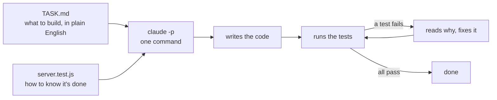

# Claude Code Shorts: the example files

The real files from Joel Stevick's YouTube Shorts on Claude Code, one folder per Short, so you can read them,
run them, and copy the setup for your own work.

Every Short in this series uses the same way of working:

1. **A task file** (`TASK.md`) says what to build and the rules it has to follow, in plain English.
2. **Tests** say how to know it's done. They are code, because Claude Code has to run them and see pass or fail.
3. **One command** in a terminal hands both to Claude Code and tells it to keep going until the tests pass.



## The Shorts

| Folder | Short | What it shows |
|---|---|---|
| [`00-what-it-is`](00-what-it-is) | What Claude Code Actually Is | The program behind the chat, and a small example: slugify, three tests, one command |
| [`01-walk-away`](01-walk-away) | Give Claude Code a task and walk away | The two files and the one command; Claude Code builds a URL shortener by itself |
| [`02-tests`](02-tests) | How to write the tests Claude Code works toward | Turning each rule in the task file into a test that checks it |
| [`03-task-file`](03-task-file) | Write a task file Claude Code can't misread | The same job from a two-line task file and from seven checkable rules: 2 of 5 tests pass, then 5 of 5 |
| [`04-claude-md`](04-claude-md) | CLAUDE.md: what Claude Code can't guess | What it already does with no CLAUDE.md, the one fact it couldn't see (old orders point to products), and why not to count on it |
| [`05-spec-first`](05-spec-first) | Claude Code skills, explained | The spec-first plugin (a skill plus a hook) and a real run: rules and tests, an OK, a locked build |
| [`06-commit-and-pr`](06-commit-and-pr) | Claude Code writes my commit messages | The commit-and-pr plugin on a real change: the commit message and pull request description it wrote |
| [`07-write-tests`](07-write-tests) | Claude Code writes my tests | The write-tests plugin on a real change: seven tests, each proven to fail when the code is broken |
| [`08-free-disk-space`](08-free-disk-space) | I ran out of disk space | The free-disk-space plugin on a real Mac: 12 GB free to 146 GB, and a nightly cleanup job |
| [`09-fix-bug`](09-fix-bug) | A skill that finds the cause of a bug | The fix-bug plugin on a real bug: a failing test first, a one-line fix, 49 tests passing |
| [`10-update-docs`](10-update-docs) | A skill that keeps your README true | The update-docs plugin on a real project: 75 claims checked against the code, 73 true, 2 fixed |
| [`11-test-in-browser`](11-test-in-browser) | Claude Code tests my website in a real browser | The test-in-browser plugin (Playwright MCP) on joelstevick.com: one real bug found, 7 tests written for CI |
| [`12-ci-failure`](12-ci-failure) | Claude Code subagents vs skills | The ci-failure plugin on a real Vite CI failure: the cause the author fixed, with the conversation growing by 2,803 tokens instead of 26,056 |

## The plugin

[`plugins/spec-first`](plugins/spec-first) is a Claude Code plugin you can install: it turns a request into checkable rules and tests, waits for your OK, then builds with the tests locked.

```
/plugin marketplace add AiFirstDevelopment/claude-code-shorts
/plugin install spec-first@claude-code-shorts
```

## Running an example

You need [Node.js](https://nodejs.org) 20 or later and [Claude Code](https://docs.claude.com/en/docs/claude-code).

```sh
cd 01-walk-away
npm test                      # the tests pass against the server Claude Code wrote
rm server.js && npm test      # take its work away: now they fail
claude -p "Build what TASK.md says. Keep going until npm test passes." \
  --permission-mode acceptEdits \
  --allowedTools "Bash(npm test)"
npm test                      # and pass again
```

`--permission-mode acceptEdits` lets it write files without asking, and `--allowedTools "Bash(npm test)"` lets it
run the tests and nothing else.

## More

The videos are on [YouTube](https://www.youtube.com/@JoelStevick); the free course they belong to is at
[joelstevick.com](https://joelstevick.com).
