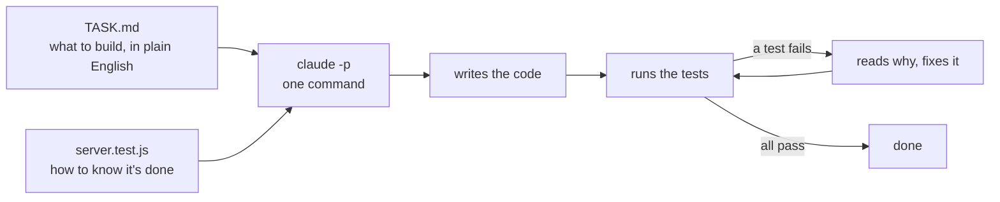

# Claude Code Shorts: the example files

The real files from Joel Stevick's YouTube Shorts on Claude Code, one folder per Short, so you can read them,
run them, and copy the setup for your own work.

Every Short in this series uses the same way of working:

1. **A task file** (`TASK.md`) says what to build and the rules it has to follow, in plain English.
2. **Tests** say how to know it's done. They are code, because Claude Code has to run them and see pass or fail.
3. **One command** in a terminal hands both to Claude Code and tells it to keep going until the tests pass.



## The Shorts

| Folder | Short | What it shows |
|---|---|---|
| [`01-walk-away`](01-walk-away) | Give Claude Code a task and walk away | The two files and the one command; Claude Code builds a URL shortener by itself |
| [`02-tests`](02-tests) | How to write the tests Claude Code works toward | Turning each rule in the task file into a test that checks it |

## Running an example

You need [Node.js](https://nodejs.org) 20 or later and [Claude Code](https://docs.claude.com/en/docs/claude-code).

```sh
cd 01-walk-away
npm test                      # the tests pass against the server Claude Code wrote
rm server.js && npm test      # take its work away: now they fail
claude -p "Build what TASK.md says. Keep going until npm test passes." \
  --permission-mode acceptEdits \
  --allowedTools "Bash(npm test)"
npm test                      # and pass again
```

`--permission-mode acceptEdits` lets it write files without asking, and `--allowedTools "Bash(npm test)"` lets it
run the tests and nothing else.

## More

The videos are on [YouTube](https://www.youtube.com/@JoelStevick); the free course they belong to is at
[joelstevick.com](https://joelstevick.com).
