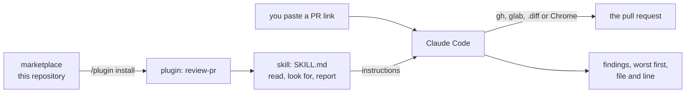

# review-pr: a Claude Code plugin

Paste a link to a pull request or merge request, and Claude Code reviews it: bugs, security problems, missing tests,
and anything that doesn't match the description, worst first, with file and line. It posts nothing unless you ask.

## Install

In Claude Code:

```
/plugin marketplace add AiFirstDevelopment/claude-code-shorts
/plugin install review-pr@claude-code-shorts
```

Then paste a link, or run the skill by name:

```
/review-pr https://github.com/owner/repo/pull/123
```

## What it needs to see the pull request

Any one of these:

| How | Set up once | Works for |
|---|---|---|
| The `gh` tool | install it, then `gh auth login` | GitHub, public and private |
| The `glab` tool | install it, then `glab auth login` | GitLab, public and private |
| Nothing | - | public GitHub pull requests (it downloads the `.diff`) |
| The Claude in Chrome extension | install and connect it; be signed in to GitHub or GitLab in Chrome | anything you can open in Chrome; slower |

If none is set up, it tells you which to set up.

## A skill and a plugin

- The **skill** is [`skills/review-pr/SKILL.md`](skills/review-pr/SKILL.md): plain instructions, what to read, what
  to look for, how to report. Claude Code reads its description in every session and follows it when you paste a
  link or type `/review-pr`.
- The **plugin** is the package around it, so anyone can install it with the two commands above. A plugin can hold
  more than skills (hooks, slash commands, subagents, MCP servers); this one needs only the skill. The
  [spec-first plugin](../spec-first) adds a hook as well.


