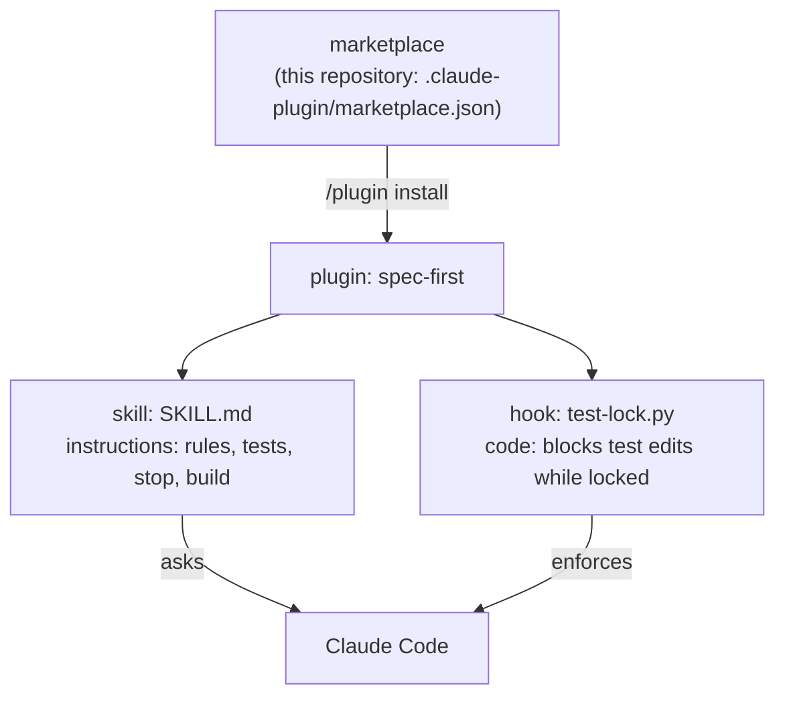

# spec-first: a Claude Code plugin

Build a feature to a spec: Claude Code writes the rules and the tests first, waits for your OK, then builds until the
tests pass, and it can't change the tests to make them pass.

## Install

In Claude Code:

```
/plugin marketplace add AiFirstDevelopment/claude-code-shorts
/plugin install spec-first@claude-code-shorts
```

Then ask for a feature, or run the skill by name:

```
/spec-first Add a way to change a link's url.
```

To try it for one session without installing: `claude --plugin-dir path/to/claude-code-shorts/plugins/spec-first`.

## What it does

1. **The task file.** It writes the rules into `TASK.md`: each one a request and its answer, plus who is allowed to
   do what and what must never happen. Any choice your request left open is written as a rule marked `(assumed)`.
2. **The tests, then it stops.** It writes a test for every rule, from the outside (send the request, check the
   answer), shows you each rule next to its test, runs them to show they fail, and **waits for your OK**.
3. **Locked tests, then the build.** On your OK it creates `.spec-lock`, builds, and runs the tests until they pass.
   While the lock exists, the plugin's hook refuses any edit to a test file. If a test is wrong, it stops and tells
   you; only you remove the lock.

## What's inside

| File | What it is |
|---|---|
| [`.claude-plugin/plugin.json`](.claude-plugin/plugin.json) | The plugin's name, description and version |
| [`skills/spec-first/SKILL.md`](skills/spec-first/SKILL.md) | **The skill**: the three steps, in plain English, that Claude Code follows |
| [`hooks/hooks.json`](hooks/hooks.json) | **The hook**: runs `bin/test-lock.py` before every Edit, Write and MultiEdit |
| [`bin/test-lock.py`](bin/test-lock.py) | Blocks edits to test files while `.spec-lock` exists (exit 2 blocks, with the reason) |

## A skill and a plugin

- A **skill** is instructions: a folder with a `SKILL.md` that says what to do and when. Claude Code reads its
  description in every session and loads the full instructions when your request matches, or when you type its name.
  A skill can only ask; Claude Code follows it the way it follows any instruction.
- A **plugin** is a package you install with one command. It can hold skills, and also things a skill can't be:
  **hooks** (code that runs on every tool call and can block it), slash commands, subagents and MCP servers.
- How they relate: the plugin is how the skill is shared, and the hook is what makes one rule in it a guarantee. The
  skill says "don't edit the tests"; the hook makes it impossible.



A real run is in [`05-spec-first`](../../05-spec-first).
